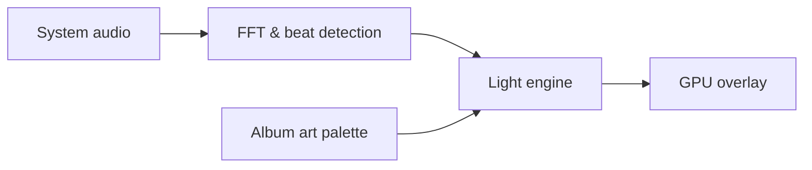

<p align="center">
  
</p>

<!-- The downloads badge counts the x64 installer only. GitHub's total for every file would mostly count update checks:
     each installed copy downloads the update feed (releases.<channel>.json) of the newest releases on every check. -->
<p align="center">
  <a href="https://github.com/sussyswimmer/bordervisualizer/releases/latest"></a>
  <a href="https://github.com/sussyswimmer/bordervisualizer/releases"></a>
  <a href="https://github.com/sussyswimmer/bordervisualizer/actions/workflows/ci.yml"></a>
  <a href="LICENSE"></a>
  
  
  
</p>

<p align="center">
  <b>Ambient edge lighting for Windows and Mac that dances to whatever you're playing.</b><br>
  Colors from the album art. Motion from the beat. Free and open source.
</p>

<p align="center">
  <a href="https://github.com/sussyswimmer/bordervisualizer/releases/latest/download/RimlightSetup.exe">
    
  </a>
  <a href="https://github.com/sussyswimmer/bordervisualizer/releases/latest/download/RimlightSetup.dmg">
    
  </a>
</p>

<p align="center">
  <sub>
    Windows 10 (version 2004 or later) and Windows 11, x64 ·
    <a href="https://github.com/sussyswimmer/bordervisualizer/releases/latest/download/RimlightSetup-arm64.exe">ARM64 installer</a> ·
    portable zip for <a href="https://github.com/sussyswimmer/bordervisualizer/releases/latest/download/Rimlight-win-Portable.zip">x64</a>
    or <a href="https://github.com/sussyswimmer/bordervisualizer/releases/latest/download/Rimlight-win-arm64-Portable.zip">ARM64</a> ·
    <a href="https://github.com/sussyswimmer/bordervisualizer/releases">all releases</a><br>
    Mac preview: macOS 14.4 or later, Apple silicon and Intel
  </sub>
</p>

<!-- Demo GIF: un-comment this block and delete the placeholder below it once assets/demo.gif exists
     (docs/RELEASE-GUIDE.md, "Record the demo GIF").
<p align="center">
  
</p>
-->
<p align="center"><i>A demo of the glow in motion is coming soon.</i></p>

<!-- Demo video: paste the video link from docs/RELEASE-GUIDE.md here, on a line of its own with a blank line
     above and below, and GitHub shows it as a player under the GIF.
https://github.com/user-attachments/assets/REPLACE-WITH-THE-VIDEO-ID
-->

## Features

<table>
  <tr>
    <td width="50%" valign="top">
      <b>🥁 Beat-synced</b><br>
      Brightness follows the loudness, and every kick sends a pulse through the glow.
    </td>
    <td width="50%" valign="top">
      <b>🎨 Album-art colors</b><br>
      Two colors from the cover of whatever's playing, crossfading when the song changes. Or pick your own.
    </td>
  </tr>
  <tr>
    <td width="50%" valign="top">
      <b>🖱️ Click-through &amp; invisible to your workflow</b><br>
      Clicks, typing and dragging go straight through. It never takes focus and stays out of Alt+Tab and the taskbar (on a Mac, ⌘Tab and the Dock).
    </td>
    <td width="50%" valign="top">
      <b>🖥️ Multi-monitor</b><br>
      Every screen, sharp at any display scaling, rebuilt on its own when you plug a monitor in or out.
    </td>
  </tr>
  <tr>
    <td width="50%" valign="top">
      <b>🎮 Pauses for games &amp; fullscreen</b><br>
      A fullscreen game or video pauses the glow on that screen only. Locking the PC pauses it everywhere.
    </td>
    <td width="50%" valign="top">
      <b>🪶 Tiny footprint</b><br>
      Drawn on the GPU, it stops drawing when nothing changes and saves power on battery.
    </td>
  </tr>
</table>

## Screenshots

Settings follows your Windows light or dark theme, and every change applies live, with a preview of the glow at the top.

<!-- Settings screenshots: un-comment this block and delete the placeholder below it once
     assets/settings-dark.png and assets/settings-light.png exist (docs/RELEASE-GUIDE.md, "Take the Settings screenshots").
<p align="center">
  <picture>
    <source media="(prefers-color-scheme: dark)" srcset="assets/settings-dark.png">
    <source media="(prefers-color-scheme: light)" srcset="assets/settings-light.png">
    
  </picture>
</p>
-->
<p align="center"><i>Screenshots of the Settings window are coming soon.</i></p>

## Install

### Windows

1. **Download [RimlightSetup.exe](https://github.com/sussyswimmer/bordervisualizer/releases/latest/download/RimlightSetup.exe)**, or [RimlightSetup-arm64.exe](https://github.com/sussyswimmer/bordervisualizer/releases/latest/download/RimlightSetup-arm64.exe) on a Windows on ARM PC.
2. **Run it.** Rimlight installs for your user account, with no admin prompt, and starts in the tray. If you don't see its icon, click **^** next to the clock.
   > Windows may say *Windows protected your PC* because the app isn't code-signed yet. Click **More info → Run anyway**.
3. **Play some music**, then look at the edges of your screen.

**Ctrl+Alt+L** turns the glow on and off. Double-click the tray icon for Settings, or right-click it for modes, colors and presets. Rimlight starts with Windows and keeps itself up to date; you can turn off both in **Settings > Behavior**.

**Portable:** prefer no installer? Unzip [Rimlight-win-Portable.zip](https://github.com/sussyswimmer/bordervisualizer/releases/latest/download/Rimlight-win-Portable.zip) (or [the ARM64 one](https://github.com/sussyswimmer/bordervisualizer/releases/latest/download/Rimlight-win-arm64-Portable.zip)) into any folder and run `Rimlight.exe`.

**winget:** coming soon.

### Mac (preview)

The Mac app is new: it's built and tested by CI on every change, but hasn't had much use on real Macs yet. [Bug reports](https://github.com/sussyswimmer/bordervisualizer/issues/new?template=bug_report.yml) are very welcome.

1. **Download [RimlightSetup.dmg](https://github.com/sussyswimmer/bordervisualizer/releases/latest/download/RimlightSetup.dmg)**, open it, and drag **Rimlight** onto **Applications**.
2. **Open Rimlight from Applications.** macOS says it can't check the app, because it isn't notarized by Apple yet.
   > On macOS 15 or later, click **Done**, then open **System Settings > Privacy & Security**, scroll down to the message about Rimlight, and click **Open Anyway**. On macOS 14, Control-click the app and choose **Open** instead.
3. **Allow system audio** when macOS asks. Rimlight appears under **System Audio Recording Only** in **Privacy & Security > Screen & System Audio Recording**. It hears only what your Mac plays, never the microphone.
4. **Play some music**, then look at the edges of your screen.

**⌃⌥L** turns the glow on and off. Rimlight lives in the menu bar: click its icon for modes, colors, presets and **Settings…**. It opens at login and keeps itself up to date; you can turn off both in **Settings**.

Album-art colors come from the Music app, which asks once whether Rimlight may read the cover. Spotify and other players get your own colors from **Settings > Color**. Because the app isn't signed with an Apple Developer ID, macOS may ask for the audio and Music permissions again after an update.

## How it works

Rimlight listens to what your PC plays through WASAPI loopback, the same sound your speakers get, and never the microphone.<br>
An FFT splits that sound into bands, and a beat detector watches the bass for kicks while auto-gain keeps the glow lively at any volume.<br>
Meanwhile it reads the album art from Windows' media controls and picks two colors from the cover that glow well.<br>
The light engine turns the beat, the loudness and those colors into a glow, which Direct3D draws into click-through windows along every screen's edges.

The Mac app shares the same engine, compiled ahead of time into a native library. It hears the Mac through a Core Audio system tap, reads the cover from the Music app, and draws with Metal.



## Privacy

Anything that listens should say exactly what it does with what it hears:

- Only system output audio is captured, via WASAPI loopback on Windows and a Core Audio system audio tap on a Mac. The microphone is never opened.
- Audio is analyzed in memory and immediately discarded. The sound is never recorded or saved. Only the audio visualizer for developers (`--debug-visualizer`) can save the numbers it computed, like loudness and beats, to a file on your PC, when you click **Record 2 min**.
- Track info and artwork are read locally, from Windows' media controls or the Mac's Music app, and never leave the device.
- No telemetry or analytics. The only network call is the GitHub update check.

You can turn off the update check in **Settings > Behavior > Update automatically** (on a Mac, **Settings > About**). The same promise is in **Settings > About**, and all the code is here to check.

## FAQ

<details>
<summary><b>Does it use my microphone?</b></summary>

No. Rimlight captures only system output audio, the sound your speakers or headphones play, through WASAPI loopback (on a Mac, a system audio tap). It never opens the microphone or any other input, and it never asks for microphone permission. The sound is analyzed in memory and thrown away right away, and nothing is recorded or saved. See [Privacy](#privacy).

</details>

<details>
<summary><b>Will it slow down games?</b></summary>

It's built not to. The glow is drawn on the GPU and only redraws when it changes: 60 times a second while music drives it (the default **Frame rate limit**, never above your display's rate), about 10 times a second while it breathes in Idle Glow, and not at all while it holds still. When a game fills a screen, the glow on that screen pauses and its overlay window is hidden, so the game has that display to itself. If you play with the glow on, you can lower **Frame rate limit** to 30 in **Settings > Displays**.

</details>

<details>
<summary><b>Battery impact?</b></summary>

On battery, Rimlight saves power by default: **On battery** in **Settings > Behavior** is set to **Save power (30 fps)**, which caps the glow at 30 frames a second and draws it at half resolution. Choose **Pause the glow** to stop it on battery, or **Keep going** for the full frame rate. It also stops drawing while the PC is locked or asleep and while the display is off. The **Off** mode stops everything, audio capture included.

</details>

<details>
<summary><b>Why doesn't it show over my fullscreen game?</b></summary>

That's on purpose. With **Pause in fullscreen apps** on (in **Settings > Behavior**, and on by default), a game, video or presentation that fills a screen pauses the glow on that screen only. Your other monitors keep glowing, and the glow comes back when the app leaves fullscreen. A maximized window doesn't count; a video in fullscreen does.

Turn the setting off if you want the glow over fullscreen apps too. Some games use exclusive fullscreen, which keeps every other window off the screen; switch the game to borderless or windowed fullscreen to see the glow there.

</details>

<details>
<summary><b>Which music apps work?</b></summary>

For the motion, all of them: Rimlight reacts to whatever your PC plays, from any player, browser, game or video.

The album-art colors need the app to share what's playing with Windows' media controls (the song and cover that show up with the volume controls on Windows 10, or in Quick Settings on Windows 11). Most music players and browsers do. When an app doesn't, or a song has no cover, the glow uses your own colors from **Settings > Color**, where you can also choose **Manual** to always use them.

</details>

<details>
<summary><b>How do I uninstall?</b></summary>

Open Windows **Settings > Apps > Installed apps** (**Apps & features** on Windows 10), find **Rimlight**, and choose **Uninstall**. That removes the app and its shortcuts.

Your settings and logs stay in `%APPDATA%\Rimlight`, so a reinstall picks up where you left off. For a complete cleanup, delete that folder too: paste `%APPDATA%\Rimlight` into File Explorer's address bar to find it. The installer's own log, `%LOCALAPPDATA%\velopack\velopack_Rimlight.log`, can go as well.

For a portable copy, turn off **Start with Windows** in **Settings > Behavior**, quit Rimlight from the tray, and delete its folder.

On a Mac, choose **Quit Rimlight** from its menu bar icon and drag **Rimlight** from Applications to the Trash. Its settings stay in `~/Library/Application Support/Rimlight`; delete that folder too for a complete cleanup.

</details>

<details>
<summary><b>Why does my Mac say it can't open Rimlight?</b></summary>

The Mac app is signed, but not with an Apple Developer ID or notarized, so Gatekeeper asks first. The first time you open it on macOS 15 or later, click **Done**, then **Open Anyway** in **System Settings > Privacy & Security**. On macOS 14, Control-click the app and choose **Open**. Either way you only do it once. Every release is built from this repository by [GitHub Actions](https://github.com/sussyswimmer/bordervisualizer/actions/workflows/release.yml), so you can check what went into it.

</details>

<details>
<summary><b>How do I report a bug?</b></summary>

Right-click the tray icon and choose **Open logs folder**, zip the files in it, and attach the zip to a [bug report](https://github.com/sussyswimmer/bordervisualizer/issues/new?template=bug_report.yml). If Rimlight won't start, paste `%APPDATA%\Rimlight\logs` into File Explorer's address bar instead. [Reporting a bug with logs](CONTRIBUTING.md#reporting-a-bug-with-logs) walks through every step.

On a Mac, run this in Terminal and attach `rimlight-log.txt`:

```sh
log show --last 1h --predicate 'subsystem == "io.github.sussyswimmer.rimlight"' > ~/Desktop/rimlight-log.txt
```

Logs never contain audio, but have a quick look before you upload them. For a security problem, please follow [SECURITY.md](SECURITY.md) instead of opening an issue.

</details>

## Build from source

You need Windows 10 (version 2004 or later) or Windows 11, the [.NET 8 SDK](https://dotnet.microsoft.com/download/dotnet/8.0), and Git. In PowerShell:

```powershell
git clone https://github.com/sussyswimmer/bordervisualizer.git
cd bordervisualizer
dotnet run --project src/Rimlight.App
```

Quit any installed copy first, since only one Rimlight runs at a time. `dotnet build -c Release` and `dotnet test` are what CI runs, and `-- --demo` (a synthetic beat, no music needed) and `-- --debug-visualizer` (the live audio analysis) are handy while you work. [CONTRIBUTING.md](CONTRIBUTING.md#build-from-source) has the details, including how to build and test the engine on Linux or macOS.

**The Mac app** needs macOS 14.4 or later, Xcode 16 or later, and the [.NET 10 SDK](https://dotnet.microsoft.com/download/dotnet/10.0). In Terminal:

```sh
git clone https://github.com/sussyswimmer/bordervisualizer.git
cd bordervisualizer
mac/build.sh --native
open artifacts/mac/Rimlight.app
```

`mac/build.sh` without `--native` builds the universal app and `RimlightSetup.dmg`, as CI does; `swift test --package-path mac` runs the Mac tests. [docs/10-MACOS.md](docs/10-MACOS.md) explains how it's put together.

## Roadmap

- [ ] **RGB devices:** keyboards, mice and light strips that glow in sync, through Windows Dynamic Lighting.
- [ ] **Smart room lights** that follow the music.
- [ ] **Screen colors:** a mode that takes its colors from the edges of what's on screen instead of the album art.
- [ ] **Per-app rules,** such as pausing the glow during a video call.
- [ ] **winget and Microsoft Store** listings.
- [ ] **A signed and notarized Mac app,** so it opens without the Open Anyway step.
- [ ] **Album-art colors from more Mac players,** such as Spotify.

Have another idea? [Suggest a feature](https://github.com/sussyswimmer/bordervisualizer/issues/new?template=feature_request.yml).

## Contributing

Bug reports with logs, ideas and pull requests are all welcome. Rimlight is split into a portable .NET engine (beat detection, color, the light engine) and the Windows app around it (overlay, audio capture, tray and Settings), which meet at a small set of interfaces. [CONTRIBUTING.md](CONTRIBUTING.md) explains the layout, the build and tests, how commits and pull requests work, and how to send logs. Everyone who takes part agrees to the [Code of Conduct](CODE_OF_CONDUCT.md).

## Credits

Rimlight is built on these open-source projects, all MIT licensed:

- [NAudio](https://github.com/naudio/NAudio): WASAPI loopback capture
- [Vortice.Windows](https://github.com/amerkoleci/Vortice.Windows): Direct3D 11, DXGI and DirectComposition
- [WPF-UI](https://github.com/lepoco/wpfui): the Fluent look of the Settings window
- [H.NotifyIcon](https://github.com/HavenDV/H.NotifyIcon): the tray icon
- [Velopack](https://github.com/velopack/velopack): the installer and updates
- [CsWin32](https://github.com/microsoft/CsWin32): the Win32 interop
- [Sparkle](https://github.com/sparkle-project/Sparkle): updates for the Mac app

The banner's lettering is [Inter](https://github.com/rsms/inter), under the SIL Open Font License 1.1.

## License

Rimlight is released under the [MIT License](LICENSE). © 2026 [Maxwell Olander](https://maxwellolander.com).
