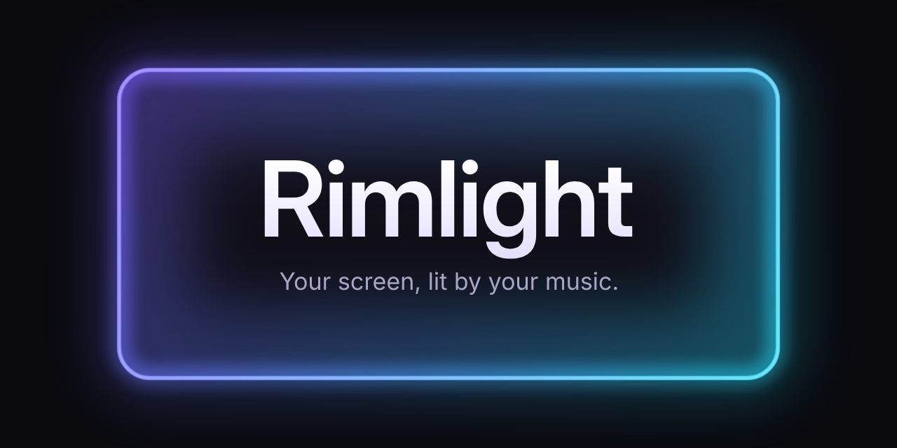
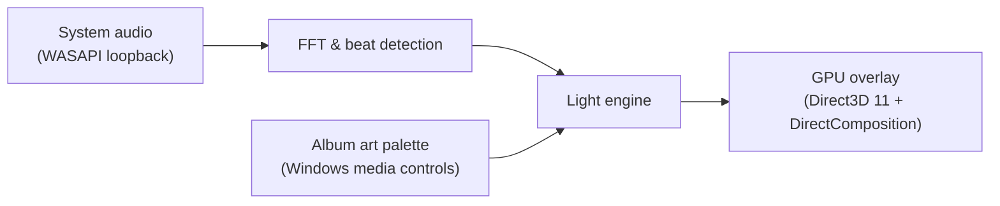

<p align="center">
  
</p>

<p align="center">
  <a href="https://github.com/sussyswimmer/bordervisualizer/releases/latest"></a>
  <a href="https://github.com/sussyswimmer/bordervisualizer/releases"></a>
  <a href="https://github.com/sussyswimmer/bordervisualizer/actions/workflows/ci.yml"></a>
  <a href="LICENSE"></a>
  
  
</p>

<p align="center">
  <b>Ambient edge lighting for Windows that dances to whatever you're playing.</b><br>
  Colors from the album art. Motion from the beat. Free and open source.
</p>

<p align="center">
  <a href="https://github.com/sussyswimmer/bordervisualizer/releases/latest/download/RimlightSetup.exe">
    
  </a>
  <br>
  <sub>Windows 10 (version 2004 or later) and 11 · x64 ·
  <a href="https://github.com/sussyswimmer/bordervisualizer/releases/latest/download/RimlightSetup-arm64.exe">ARM64</a> ·
  <a href="#install">portable zip</a> ·
  <a href="https://github.com/sussyswimmer/bordervisualizer/releases">all releases</a></sub>
</p>

<!-- Demo: once assets/demo.gif exists, replace the note below with
<p align="center"></p>
and, for the sharper MP4, the video link GitHub gives when the file is dropped into an issue comment, on its own line. -->
<p align="center"><i>A demo recording is coming soon.</i></p>

## Features

<table>
  <tr>
    <td width="50%" valign="top">🥁 <b>Beat-synced</b><br>Brightness follows the loudness, and every beat sends a pulse that flares the glow brighter and wider.</td>
    <td width="50%" valign="top">🎨 <b>Album-art colors</b><br>Two colors from the cover of whatever is playing, crossfading on every new track.</td>
  </tr>
  <tr>
    <td valign="top">🖱️ <b>Click-through &amp; invisible to your workflow</b><br>Clicks, typing and scrolling go straight through. It never takes focus and stays out of the taskbar and Alt+Tab.</td>
    <td valign="top">🖥️ <b>Multi-monitor</b><br>Every screen or just the ones you pick, sharp on mixed-DPI setups, and rebuilt when you plug a monitor in or out.</td>
  </tr>
  <tr>
    <td valign="top">🎮 <b>Pauses for games &amp; fullscreen</b><br>A fullscreen game, video or presentation pauses the glow on that screen while the others keep glowing.</td>
    <td valign="top">🪶 <b>Tiny footprint</b><br>It draws only while the light changes, and Off stops it completely. The audio and light engine uses 0.36 % of one CPU core at 60 fps (<a href="docs/PERF.md">measured</a>).</td>
  </tr>
</table>

Also in the box: five presets (Aurora, Sunset, Neon, Ember and Minimal), a calm Idle Glow mode, your own colors, rounded corners for rounded screens, a glow on/off shortcut (<kbd>Ctrl</kbd>+<kbd>Alt</kbd>+<kbd>L</kbd> by default), start with Windows, and automatic updates.

## Screenshots

<!-- Once assets/settings-dark.png and assets/settings-light.png exist, replace the note below with
<p align="center">
  <picture>
    <source media="(prefers-color-scheme: dark)" srcset="assets/settings-dark.png">
    <source media="(prefers-color-scheme: light)" srcset="assets/settings-light.png">
    
  </picture>
</p>
-->
Settings has six pages (Appearance, Color, Motion, Displays, Behavior and About), applies every change live, and follows Windows' light or dark mode. The Appearance page shows a live preview of the glow.

<p align="center"><i>Screenshots are coming soon.</i></p>

## Install

1. **Download [RimlightSetup.exe](https://github.com/sussyswimmer/bordervisualizer/releases/latest/download/RimlightSetup.exe).** On Windows on ARM, get [RimlightSetup-arm64.exe](https://github.com/sussyswimmer/bordervisualizer/releases/latest/download/RimlightSetup-arm64.exe) instead.
2. **Run it.** It installs for your user account, with no admin prompt. Rimlight starts in the notification area next to the clock and opens its Settings with a short welcome.
   > Windows may say *Windows protected your PC* because the app isn't code-signed yet. Click **More info → Run anyway**. If it says *Smart App Control blocked* the app instead, there's no Run anyway: Rimlight can't run while Smart App Control is on until releases are code-signed ([more in the FAQ](#faq)).
3. **Play some music** and look at the edges of your screen. Click the tray icon (or press <kbd>Ctrl</kbd>+<kbd>Alt</kbd>+<kbd>L</kbd>) to turn the glow on or off, double-click it for Settings, and right-click it for modes, colors and presets.

You need Windows 10 version 2004 or later, or Windows 11. The .NET runtime is included, so there is nothing else to install. Rimlight checks for a new version twice a day and installs it the next time it starts; turn that off with **Update automatically** in **Settings > Behavior**.

- **Portable:** unzip [Rimlight-win-Portable.zip](https://github.com/sussyswimmer/bordervisualizer/releases/latest/download/Rimlight-win-Portable.zip) ([ARM64](https://github.com/sussyswimmer/bordervisualizer/releases/latest/download/Rimlight-win-arm64-Portable.zip)) into any folder and run `Rimlight.exe`.
- **winget:** coming soon.

## How it works

1. **Listen.** Rimlight hears the sound your PC plays, never the microphone.
2. **Analyze.** Every frame, an FFT splits the sound into bass, mids and highs, and Rimlight follows the loudness and picks out the beats.
3. **Color.** It reads the current track's album art from Windows' media controls and turns it into two glow colors.
4. **Light.** A light engine mixes beat, loudness and colors, and the GPU draws the glow in a click-through window on each screen.



## Privacy

- Only system output audio is captured, via WASAPI loopback. The microphone is never opened.
- Audio is analyzed in memory and immediately discarded. Nothing is recorded or saved.
- Track info and artwork are read locally from Windows' media controls and never leave the device.
- No telemetry or analytics. The only network call is the GitHub update check.

With **Update automatically** off (in **Settings > Behavior**), Rimlight checks for updates only when you click **Check for updates**.

## FAQ

<details>
<summary><b>Does it use my microphone?</b></summary>

No. Rimlight captures only what your PC plays, through WASAPI loopback on the default output device, and never opens a microphone or any other input. The sound is analyzed in memory and thrown away; nothing is recorded or saved.
</details>

<details>
<summary><b>Will it slow down games?</b></summary>

It's built to stay out of the way. With **Pause in fullscreen apps** on (the default), a game that fills a screen pauses the glow on that screen, and Rimlight hides its window there. On other screens it draws at most at your frame rate limit (60 fps unless you change it in **Settings > Displays**) and skips frames while the light doesn't change. Its audio and light engine takes about 0.36 % of one CPU core at 60 fps; that was [measured](docs/PERF.md) on the engine alone, in an 8-hour run on a Linux VM. To turn the glow off, press <kbd>Ctrl</kbd>+<kbd>Alt</kbd>+<kbd>L</kbd>; press it again to turn it back on.
</details>

<details>
<summary><b>Battery impact?</b></summary>

On battery, Rimlight caps the glow at 30 fps and draws it at half resolution (**Save power**, the default under **On battery** in **Settings > Behavior**). Choose **Pause the glow** to stop it on battery, or **Keep going** for full speed. Idle Glow redraws only 10 times a second, and Off stops drawing altogether.
</details>

<details>
<summary><b>Why doesn't it show over my fullscreen game?</b></summary>

That's on purpose. With **Pause in fullscreen apps** on (the default), anything that fills a screen, such as a game, a fullscreen video or a presentation, pauses the glow on that screen; your other screens keep glowing. The glow also pauses while presentation settings are on, while the PC is locked and while the display is off. To keep the glow on in fullscreen, turn off **Pause in fullscreen apps** in **Settings > Behavior**. A game in exclusive fullscreen mode usually has the screen to itself, so no window can draw over it; pick borderless or windowed fullscreen in the game's settings.
</details>

<details>
<summary><b>Which music apps work?</b></summary>

The glow moves with anything your PC plays (music apps, browsers, videos and games), because Rimlight listens to the default output device. The album colors come from apps that share what's playing with Windows' media controls, the panel that shows the track when you press a media key; most music apps and browsers do. Without a cover, the glow uses your own colors from **Settings > Color**. A player set to exclusive-mode output bypasses the Windows mixer, so the glow can't hear it; switch the player to shared mode.
</details>

<details>
<summary><b>Why does Windows warn about the installer, or block it?</b></summary>

Rimlight isn't code-signed yet, so Windows doesn't recognize it. *Windows protected your PC* (SmartScreen) is a warning: click **More info → Run anyway**. *Smart App Control blocked* is a hard stop on Windows 11: while Smart App Control is on, it blocks unsigned apps that Windows doesn't already know, and there is no Run anyway. The setting is in **Windows Security > App & browser control > Smart App Control settings**. Turning it off is your call; on some versions of Windows it can't be turned back on without reinstalling Windows. The block ends once releases are code-signed. Every release is built from this repository by the [release workflow](.github/workflows/release.yml).
</details>

<details>
<summary><b>How do I uninstall?</b></summary>

Open Windows **Settings > Apps > Installed apps** (**Apps & features** on Windows 10), find Rimlight and choose **Uninstall**. That removes the app, its shortcuts and its start-up entry. Your settings and logs stay in `%APPDATA%\Rimlight`; delete that folder to remove them too. For the portable version, turn off **Start with Windows** in **Settings > Behavior**, quit Rimlight and delete its folder.
</details>

<details>
<summary><b>How do I report a bug?</b></summary>

Right-click the tray icon and choose **Open logs folder** (or paste `%APPDATA%\Rimlight\logs` into File Explorer's address bar), zip the files, and attach the zip to a [bug report](https://github.com/sussyswimmer/bordervisualizer/issues/new?template=bug_report.yml). Logs never contain audio. [Reporting a bug with logs](CONTRIBUTING.md#reporting-a-bug-with-logs) has the details. Security problems go through [SECURITY.md](SECURITY.md) instead.
</details>

## Build from source

You need Windows 10 (version 2004 or later) or Windows 11, the [.NET 8 SDK](https://dotnet.microsoft.com/download/dotnet/8.0) and Git. In PowerShell:

```powershell
git clone https://github.com/sussyswimmer/bordervisualizer.git
cd bordervisualizer
dotnet run --project src/Rimlight.App
```

Quit any installed copy first: only one Rimlight runs at a time. `dotnet test` runs the tests, `dotnet run --project src/Rimlight.App -- --demo` plays a synthetic beat so you can see the glow without music, and `-- --debug-visualizer` opens a live view of the beat detection. [CONTRIBUTING.md](CONTRIBUTING.md) covers the project layout, and how to [build the engine on Linux or macOS](CONTRIBUTING.md#without-windows).

## Roadmap

- [ ] RGB keyboards, mice and light strips in sync with the glow, through Windows Dynamic Lighting
- [ ] Smart room lights that follow the music
- [ ] Screen color mode: the glow takes its colors from the edges of what's on screen
- [ ] Per-app rules, such as pausing during video calls
- [ ] winget and Microsoft Store listings

## Contributing

Bug reports with logs, ideas and pull requests are all welcome. [CONTRIBUTING.md](CONTRIBUTING.md) explains how to build and test, how the code is organized, and the few product rules every change keeps (system audio only, no telemetry). Please follow the [Code of Conduct](CODE_OF_CONDUCT.md).

## Credits

Rimlight is built on these open-source projects:

- [NAudio](https://github.com/naudio/NAudio) for WASAPI loopback capture
- [Vortice.Windows](https://github.com/amerkoleci/Vortice.Windows) for Direct3D 11, DXGI and DirectComposition
- [WPF-UI](https://github.com/lepoco/wpfui) for the Fluent settings window
- [H.NotifyIcon](https://github.com/HavenDV/H.NotifyIcon) for the tray icon
- [Velopack](https://github.com/velopack/velopack) for the installer and updates
- [CsWin32](https://github.com/microsoft/CsWin32) for the Win32 interop

## License

[MIT](LICENSE) © Maxwell Olander · [maxwellolander.com](https://maxwellolander.com)
