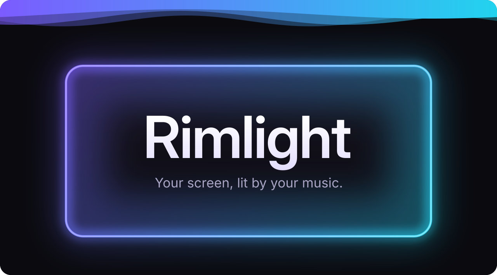
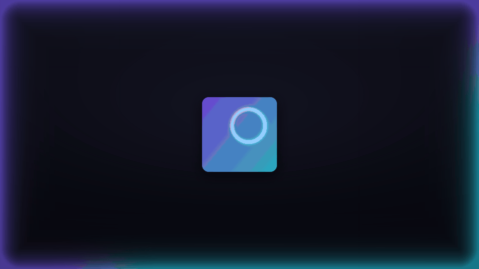
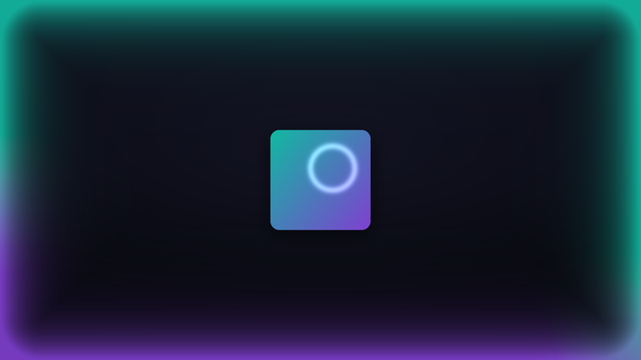
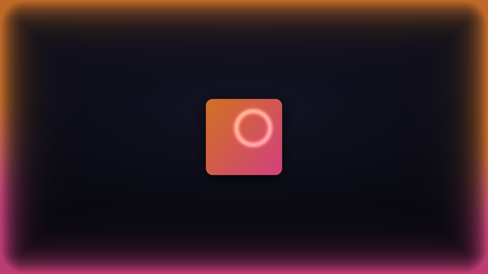
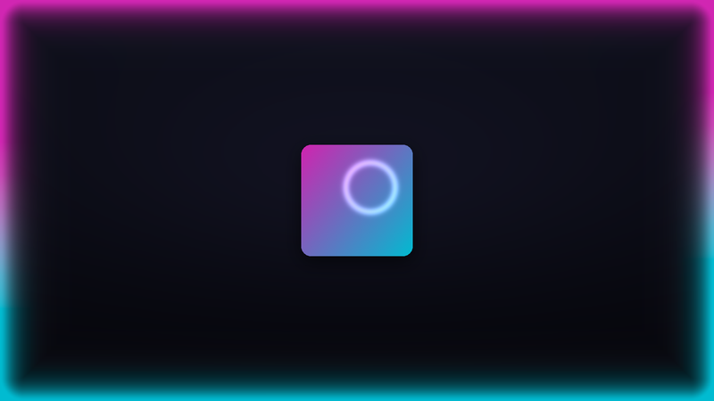
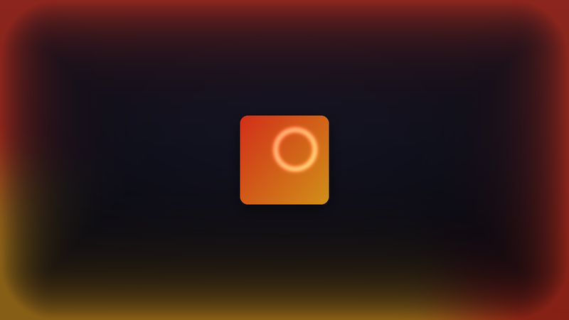
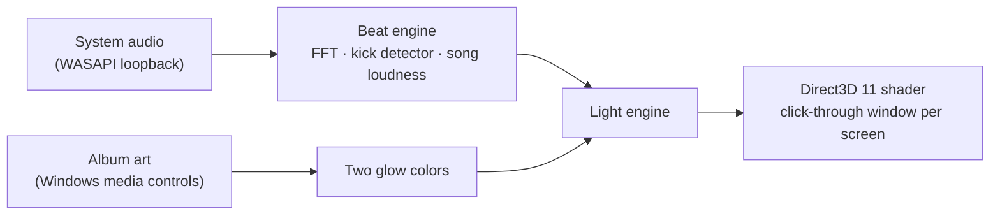

<p align="center">
  
</p>

<p align="center">
  <b>The edges of your screen glow with your music.</b><br>
  Colors from the album art. Motion from the beat. Free for Windows and Mac.
</p>

<p align="center">
  <a href="https://github.com/sussyswimmer/bordervisualizer/releases/latest/download/RimlightSetup.exe"></a>
  <a href="https://github.com/sussyswimmer/bordervisualizer/releases/latest/download/RimlightSetup.dmg"></a>
</p>

<p align="center">
  <a href="#looks">Looks</a> &nbsp;·&nbsp; <a href="#how-it-works">How it works</a> &nbsp;·&nbsp; <a href="#install">Install</a> &nbsp;·&nbsp; <a href="#faq">FAQ</a>
</p>

<p align="center">
  <br>
  <sub>Rendered with Rimlight's own beat engine and glow shader.</sub>
</p>

## Looks

<table>
  <tr>
    <td><p align="center"><b>Aurora</b></p></td>
    <td><p align="center"><b>Sunset</b></p></td>
  </tr>
  <tr>
    <td><p align="center"><b>Neon</b></p></td>
    <td><p align="center"><b>Ember</b></p></td>
  </tr>
</table>

Or let the album art pick the colors, which is the default.

## How it works

🎧 &nbsp;**Listens** to what your PC plays. Never the microphone.<br>
🥁 &nbsp;**Finds the beat.** Calm songs breathe; rap and EDM hit on the kick.<br>
🎨 &nbsp;**Takes the colors** from the album art.<br>
✨ &nbsp;**Draws the glow** on your graphics card. Clicks go straight through.

🔒 No tracking. The only network requests are the update check and, on a Mac, Spotify's album cover.

<details>
<summary><b>How it's built</b></summary>



- **C# and .NET 8**, with a WPF + WPF-UI Settings window and a tray icon.
- **The beat engine** runs about once a frame in a fraction of a millisecond, and allocates nothing while it runs.
- **Tuned on real music:** 15 Creative Commons songs, from quiet folk to trap ([`tools/corpus`](tools/corpus)).
- **Tested:** about 1,400 automated tests on Linux and Windows.

</details>

## Install

1. Download **[RimlightSetup.exe](https://github.com/sussyswimmer/bordervisualizer/releases/latest/download/RimlightSetup.exe)** ([ARM64](https://github.com/sussyswimmer/bordervisualizer/releases/latest/download/RimlightSetup-arm64.exe) · [portable zip](https://github.com/sussyswimmer/bordervisualizer/releases/latest/download/Rimlight-win-Portable.zip)).
2. Run it. If Windows says *Windows protected your PC*, click **More info → Run anyway**.
3. Play some music.

**Ctrl+Alt+L** turns the glow on and off. Double-click the tray icon for Settings. Windows 10 and 11.

**Mac** (macOS 14.4 or later): open **[RimlightSetup.dmg](https://github.com/sussyswimmer/bordervisualizer/releases/latest/download/RimlightSetup.dmg)** and drag Rimlight to Applications. The first time, macOS blocks it: click **Done**, then **Open Anyway** in **System Settings > Privacy & Security**. **⌃⌥L** turns the glow on and off.

## FAQ

<details>
<summary><b>Does it use my microphone?</b></summary>

No. It only hears what your speakers play, and that sound is never saved.

</details>

<details>
<summary><b>Will it slow down games?</b></summary>

No. A fullscreen game pauses the glow on its screen, and the glow only redraws when it changes.

</details>

<details>
<summary><b>What about battery?</b></summary>

On battery it runs at 30 frames a second by default. You can pause it on battery in **Settings > Behavior**.

</details>

<details>
<summary><b>Which music apps work?</b></summary>

All of them for the beat. The album colors need an app that shows its song in Windows' media controls, as most players and browsers do.

</details>

<details>
<summary><b>How do I uninstall?</b></summary>

**Settings > Apps > Installed apps > Rimlight > Uninstall.** Your settings stay in `%APPDATA%\Rimlight` in case you come back.

</details>

<details>
<summary><b>Found a bug?</b></summary>

Right-click the tray icon, choose **Open logs folder**, and attach the files to a [bug report](https://github.com/sussyswimmer/bordervisualizer/issues/new?template=bug_report.yml).

</details>

<details>
<summary><b>Build from source</b></summary>

With Windows, the [.NET 8 SDK](https://dotnet.microsoft.com/download/dotnet/8.0) and Git:

```powershell
git clone https://github.com/sussyswimmer/bordervisualizer.git
cd bordervisualizer
dotnet run --project src/Rimlight.App
```

[CONTRIBUTING.md](CONTRIBUTING.md) has the rest.

</details>

---

<sub>Built with [NAudio](https://github.com/naudio/NAudio), [Vortice.Windows](https://github.com/amerkoleci/Vortice.Windows), [WPF-UI](https://github.com/lepoco/wpfui), [H.NotifyIcon](https://github.com/HavenDV/H.NotifyIcon), [Velopack](https://github.com/velopack/velopack) and [CsWin32](https://github.com/microsoft/CsWin32). [Sparkle](https://github.com/sparkle-project/Sparkle) on the Mac. Lettering: [Inter](https://github.com/rsms/inter) (SIL OFL 1.1). [MIT License](LICENSE) © 2026 [Maxwell Olander](https://maxwellolander.com).</sub>

<p align="center">
  
</p>
